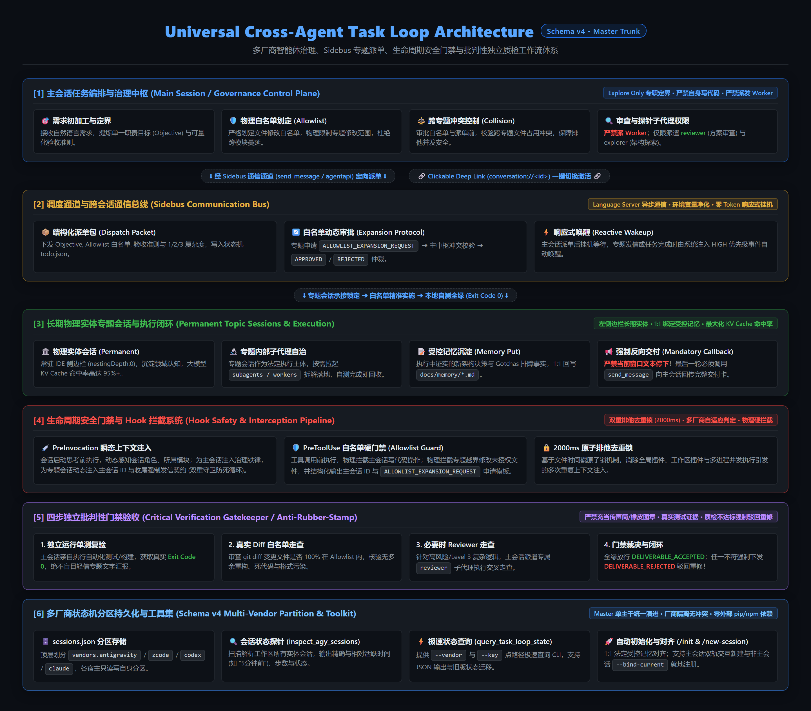

# Task Loop (`task-loop`)

通用跨 Agent 任务循环调度器（Universal Cross-Agent Task Loop），全面支持 **Antigravity (AGY)**、**ZCode (Z.ai)**、**OpenAI Codex** 和 **Anthropic Claude Code**。



---

## [Core Features] 核心特性

- **多厂商环境感知（Vendor-Agnostic）**：自动扫描并解析当前项目的历史 Agent 会话（AGY / ZCode / Codex / Claude），提取交互元数据与上下文。
- **智能打标与专题会话路由（Auto-Tagging & Routing）**：主会话 AI 结合工程架构对各个专题会话进行语义化分类与标签化（`tags` / `module_key`），构建项目专题拓扑；主会话负责直接主理 `docs/` 与记忆文档防失真，并通过 sidebus 派单至专题会话独立开发业务代码，由专题会话按需拉起 subagents 实施落地。
- **1 / 2 / 3 复杂度分级调度（Complexity Tiering）**：
  - **Level 1（简单）**：单点 Bugfix / 单文件修改，直发单线程极速闭环。
  - **Level 2（标准）**：模块内功能开发与重构，边界约束内自测与专题记忆回写。
  - **Level 3（复杂）**：跨模块架构演进 / 耗时 > 3 分钟，强制 Subagent 编排（Research / Worker / Reviewer 并行流转）。
- **双运行时环境支持（Dual Runtime: Node.js & Python）**：Node.js (18+) 为 Primary 主力黄金事实源（零 npm 外部依赖，极速启动）；Python (3.8+) 为等价标准库薄适配（零 pip 外部依赖），契约测试保障 100% 行为等价。

---

## [Session Mechanics] 插件操作会话的基础原理与跨平台底层架构

不同 AI 宿主对“会话（Session / Thread / Conversation）”的底层暴露方式截然不同。本插件通过抽象统一的 **六大标准会话原语 (`SessionProvider`)** 与 **双层生命周期钩子 (`PreInvocation` / `PreToolUse`)**，在底层針對四大平台采用各自原生的权威通信机制：

### 1. Google Antigravity (AGY)：原生 Built-in 工具 + `agentapi` Sidebus RPC + 磁盘物理直通
与 Claude Code Desktop（内置 `ccd_session*` MCP）和 Codex（内置 `codex_app` MCP）不同，**AGY 不通过 MCP 暴露会话管理**，而是采用三层组合原语（经 AGY 官方内置 `antigravity_guide`、`automation`、`agy-customizations/docs/hooks.md` 及 `agentapi` CLI 实测证实）：
* **L1 宿主内置工具 (`default_api`)**：
  - `send_message(Recipient, Message)`：通过 Language Server Sidebus 向目标会话或子代理投递消息（UI 渲染为 `Message from Root Agent` 折叠卡），并触发宿主原生的 **Reactive Wakeup（响应式唤醒）**——发信方无需轮询，收到回信或后台任务完成时由系统事件驱动自动恢复执行。
  - `invoke_subagent` / `define_subagent` / `manage_subagents(list|kill|kill_all)`：在当前会话内动态定义、拉起、监控与销毁树状子代理沙箱。
  - `schedule(DurationSeconds, TimerCondition)`：挂载事件驱动定时器（当 `TimerCondition` 命中目标会话回信时自动提前取消定时器并唤醒）。
* **L2 本地守护进程 CLI (`~/.gemini/antigravity/bin/agentapi.bat`)**：
  - 底层直连宿主本地 Connect RPC (`ANTIGRAVITY_LS_ADDRESS` / `LanguageServerService`)，提供三大顶层根会话控制命令：
    - `agentapi new-conversation [--model=<flash_lite|flash|pro>] [--title=<title>] -- <prompt>`：净化父级环境变量后创建 `nestingDepth: 0` 的独立顶层物理根会话（常驻 IDE 左侧列表）；
    - `agentapi send-message [--title=<title>] <recipient_id> <content>`：强制物理唤醒处于休眠态的顶层专题会话进入大模型推理；
    - `agentapi get-conversation-metadata <conversation_id>`：通过 RPC 实时校验会话存在性与工作区绑定。
* **L3 物理文件系统直通与生命周期 Hooks**：
  - **4 维物理状态探针与转录内省**：直接读取 `~/.gemini/antigravity/presence/<id>.lock`（在场锁）与 `~/.gemini/antigravity/brain/<id>/.system_generated/logs/transcript.jsonl`（全量推理步骤、Thinking 思考链与 Tool Calls），结合 `conversation://<id>` 协议实现零延迟状态交叉验证与 UI 切屏；
  - **Hooks 管道**：通过 `PreInvocation` 输出 `injectSteps: [{"ephemeralMessage": "..."}]` 实现零轨迹污染的上下文与规则注入；通过 `PreToolUse` 输出 `decision: "allow"|"deny"` 强制执行物理文件修改白名单（Allowlist）。

### 2. 四大平台会话底层实现机制权威对照矩阵 (JSON)

```json
[
  {
    "vendor": "Google Antigravity (AGY)",
    "architecture_paradigm": "Native Built-in Tools + Sidebus CLI (agentapi Connect RPC) + Disk JSONL Introspection",
    "session_id_discovery": "Runtime <user_information> / env ANTIGRAVITY_CONVERSATION_ID / Hook stdin conversationId",
    "top_level_session_spawn": "agentapi new-conversation --title=\"...\" -- \"<prompt>\" (净化父环境变量, nestingDepth: 0)",
    "cross_session_send_and_wake": "In-session: send_message(Recipient, Message) + Reactive Wakeup; CLI RPC: agentapi send-message <id> <msg>",
    "subagent_sandbox": "invoke_subagent / define_subagent / manage_subagents (list | kill | kill_all)",
    "storage_and_introspection": "~/.gemini/antigravity/brain/<id>/.system_generated/logs/transcript.jsonl + presence/<id>.lock",
    "lifecycle_hooks": "PreInvocation (injectSteps.ephemeralMessage) + PreToolUse (decision: allow | deny)"
  },
  {
    "vendor": "Anthropic Claude Code",
    "architecture_paradigm": "Desktop Built-in MCP (ccd_session / ccd_session_mgmt) + Headless CLI (-p --resume) + Scheduled Task Bridge",
    "session_id_discovery": "Hook stdin .session_id (snake_case) + ~/.claude/sessions/<pid>.json (sessionId <-> hostSessionId: local_xxx)",
    "top_level_session_spawn": "Desktop UI MCP: mcp__ccd_session__start_session / Scheduled Task Bridge (scheduled_tasks_run_scheduled_task 产出 local_<uuid>)",
    "cross_session_send_and_wake": "Desktop MCP: mcp__ccd_session_mgmt__send_message / list_sessions / list_events; CLI: claude -p --resume <uuid> \"<prompt>\" --output-format json",
    "subagent_sandbox": "Native Agent/Task subagents & claude --resume <id> --fork-session",
    "storage_and_introspection": "~/.claude/projects/<munged-cwd>/<uuid>.jsonl + ~/.claude/sessions/<pid>.json",
    "lifecycle_hooks": "SessionStart (stdout text) + UserPromptSubmit (additionalContext) + PreToolUse (Exit Code 2 block)"
  },
  {
    "vendor": "OpenAI Codex",
    "architecture_paradigm": "Desktop App MCP (codex_app) + Non-Interactive CLI (codex exec resume / codex queue)",
    "session_id_discovery": "Process env CODEX_THREAD_ID / CODEX_SESSION_ID",
    "top_level_session_spawn": "Desktop MCP: mcp__codex_app__list_projects -> mcp__codex_app__create_thread (worktree | local)",
    "cross_session_send_and_wake": "Desktop MCP: mcp__codex_app__send_message_to_thread -> wait_threads -> read_thread; CLI: codex exec resume <id> / codex queue --thread <id>",
    "subagent_sandbox": "Desktop child threads (create_thread) or CLI isolated exec",
    "storage_and_introspection": "$CODEX_HOME/sessions/YYYY/MM/DD/*.jsonl (session_meta.payload + rollout events)",
    "lifecycle_hooks": ".codex-plugin/plugin.json -> UserPromptSubmit (codex-session-health.json 监控长会话体积与轮换)"
  },
  {
    "vendor": "ZCode (Z.ai)",
    "architecture_paradigm": "In-Process Agent Tool + Headless Electron Node CLI (zcode.cjs) + SQLite/Rollout Store",
    "session_id_discovery": "Hook stdin .session_id / env ZCODE_SESSION_ID",
    "top_level_session_spawn": "ELECTRON_RUN_AS_NODE=1 ZCode.exe zcode.cjs --cwd <dir> -p \"<prompt>\" (封装于 spawn_zcode_session.js)",
    "cross_session_send_and_wake": "In-process: SendMessage(to: agent_<uuid>); Cross-session CLI: zcode --resume <sess_id> -p \"<prompt>\"",
    "subagent_sandbox": "Native Agent (Task) tool synchronous subagent execution",
    "storage_and_introspection": "~/.zcode/cli/db/db.sqlite (session, input_history 只读查询) + ~/.zcode/cli/rollout/model-io-sess_<uuid>.jsonl",
    "lifecycle_hooks": "hooks/hooks.json -> SessionStart / UserPromptSubmit (hookSpecificOutput.additionalContext) + PreToolUse (permissionDecision: deny)"
  }
]
```

---

## [Structure] 项目结构

```text
task-loop/
├── plugin.json              # Antigravity Plugin 核心声明清单
├── hooks.json               # 插件钩子管道配置 (PreInvocation / PreToolUse)
├── SKILL.md                 # Agent 核心 Skill 说明与规范
├── README.md                # 项目主说明与版本记录
├── assets/                  # 架构图与静态资源
│   └── architecture.png
├── config/                  # 用户配置与偏好定义
│   ├── user_preferences.json # 用户偏好自解释配置文件
│   └── README.md            # 配置参数详解手册
├── rules/                   # 插件内置全局治理规则
│   └── task-loop-governance.md
├── references/              # 契约与 Schema 规范
│   ├── sdk/                 # 跨厂商会话 SDK 规范目录
│   │   ├── README.md        # SDK 抽象层与厂商索引
│   │   ├── agy.md           # Google Antigravity SDK
│   │   ├── codex.md         # OpenAI Codex SDK
│   │   └── claude.md        # Anthropic Claude Code SDK
│   ├── dispatch-contract.md # 派单与初始化契约
│   └── work-item-schema.md  # 任务与会话状态字段规范
├── scripts/                 # 跨平台调度与扫描脚本集 (Node.js / Python)
│   ├── hooks/               # 钩子处理脚本集 (PreInvocation / PreToolUse)
│   │   ├── inject_session_context.js / .py
│   │   └── enforce_allowlist.js / .py
│   ├── find_project_sessions.js / .py
│   ├── initialize_task_loop_state.js / .py
│   ├── summarize_project_sessions.js / .py
│   ├── acquire_task_loop_lease.js / .py
│   ├── release_task_loop_lease.js / .py
│   ├── new_task_loop_dispatch_packet.js / .py
│   ├── reconcile_task_loop_topics.js / .py
│   ├── get_task_loop_statistics.js / .py
│   ├── invoke_task_loop_tick.js / .py
│   ├── test_task_loop_preflight.js / .py
│   └── providers/           # 各 Agent 厂商适配 Provider
│       ├── get_agy_project_sessions.js / .py
│       ├── get_codex_project_sessions.js / .py
│       └── get_claude_project_sessions.js / .py
└── tests/                   # 自动化测试与用例 (Node.js / Python)
```

---

### [Quick Start & Multi-Vendor Installation] 多厂商一键集成指南

`task-loop` 提供了业界最通用的多厂商插件规范，全面支持 **Claude Code**、**Google Antigravity**、**ZCode (Z.ai)** 与 **OpenAI Codex** 四大主流宿主。支持直接通过 GitHub 仓库地址 (`https://github.com/JHJ1848/task-loop`) 或本地一键脚本完成安装。

```json
[
  {
    "vendor": "Claude Code",
    "method": "Git 市场一键添加",
    "command": "claude plugin marketplace add https://github.com/JHJ1848/task-loop.git\nclaude plugin install task-loop@task-loop",
    "notes": "原生读取 .claude-plugin/marketplace.json 与 marketplace.json 清单"
  },
  {
    "vendor": "Google Antigravity (AGY)",
    "method": "一键脚本同步 / agy CLI",
    "command": "node scripts/install_agy_plugin.js\n# 或 agy plugin install https://github.com/JHJ1848/task-loop.git",
    "notes": "自动清理历史双副本死锁并校验 6 Skills + 2 Hooks 完整性"
  },
  {
    "vendor": "ZCode (GLM)",
    "method": "一键导出与本地市场加载",
    "command": "node scripts/install_zcode_plugin.js",
    "notes": "快照同步至 ~/.zcode/plugin-workspace/task-loop 并生成专属本地市场"
  },
  {
    "vendor": "OpenAI Codex",
    "method": "Codex CLI / Desktop 插件",
    "command": "codex plugin add task-loop@personal --json",
    "notes": "读取 .codex-plugin/plugin.json，提供稳定的降级与 CLI 分派能力"
  }
]
```

### 1. Claude Code 一键安装
Claude Code 原生支持基于 Git 的通用插件市场规范（依赖仓库根目录与 `.claude-plugin/` 下的 `marketplace.json`）：
```bash
# 1. 添加 task-loop 插件市场源
claude plugin marketplace add https://github.com/JHJ1848/task-loop.git

# 2. 安装并启用 task-loop 插件
claude plugin install task-loop@task-loop
```

### 2. Google Antigravity (AGY) 一键安装与同步
Antigravity 官方用户插件目录位于 `~/.gemini/config/plugins/task-loop/`。使用内置安装器可自动排查并清理历史死锁冲突：
```bash
# 一键安装与同步 (Node.js 18+, 推荐)
node scripts/install_agy_plugin.js

# 或 Python 3.8+ 备选
python scripts/install_agy_plugin.py

# 仅预览安装计划与死锁检测 (Dry Run)
node scripts/install_agy_plugin.js --check
```

### 3. ZCode (Z.ai) 一键导出与安装
ZCode 采用快照物理隔离机制，安装脚本自动完成白名单复制并生成 `~/.zcode/plugin-workspace/task-loop/` 本地市场：
```bash
# 一键导出与同步
node scripts/install_zcode_plugin.js

# 打开 ZCode Settings -> Plugin Management -> Discover -> [+] 添加本地目录 ~/.zcode/plugin-workspace/task-loop
```

### 4. OpenAI Codex 插件集成
Codex 支持通过 `.codex-plugin/plugin.json` 作为个人插件引入：
```powershell
codex plugin add task-loop@personal --json
codex plugin list --marketplace personal --json
```

---


---

## [ZCode Install Guide] ZCode 详细安装指南

本章节面向想在 **ZCode (Z.ai)** 宿主中使用 task-loop 的用户，完整覆盖从取码、安装、客户端加载到验证与卸载的全流程。整个流程约 3 分钟，全程零外部依赖。

### 一、前置条件

```json
[
  { "item": "ZCode 客户端 / CLI", "requirement": "3.9.x 及以上（含 Plugin Management 与本地市场能力）", "check": "Settings 菜单中存在 'Plugin Management' 即满足" },
  { "item": "Node.js", "requirement": "18+ （主力运行时；脚本与全部 Hook 基于 Node 标准库，零 npm 依赖）", "check": "node --version" },
  { "item": "Python 3.8+", "requirement": "可选。仅当使用 Python 版安装器或 Hook 兜底时需要（零 pip 依赖）", "check": "python --version" },
  { "item": "Git", "requirement": "仅用于拉取源码仓库", "check": "git --version" }
]
```

### 二、第一步: 获取项目源码 (单主干 master 统一集成)

```bash
# 克隆仓库 (master 单主干全量内置 Google AGY、ZCode、Codex、Claude 四大厂商适配层)
git clone <仓库地址> task-loop
cd task-loop

# 自检: 确认 ZCode 插件适配层存在
# Windows (PowerShell) : Test-Path .zcode-plugin/plugin.json
# macOS / Linux        : test -f .zcode-plugin/plugin.json && echo OK
```

### 三、第二步: 执行一键安装

```bash
# 基础安装 (Node.js 18+, 推荐)
node scripts/install_zcode_plugin.js

# 或 Python 3.8+ 备选 (零 pip 依赖, 与 Node 版行为一致)
python scripts/install_zcode_plugin.py
```

脚本自动完成三件事:

1. **校验源仓库**: 读取 `.zcode-plugin/plugin.json` 并校验 name 满足 ZCode 清单规范 `^[a-z0-9][a-z0-9._-]{0,127}$`;
2. **白名单快照复制**: 只拷贝运行时必需集合到默认目标 `~/.zcode/plugin-workspace/task-loop/`（幂等覆盖，重跑即刷新），同时排除一切开发态内容;
3. **生成市场清单**: 在目标根部写入 `marketplace.json`（市场名 `task-loop-local`, 插件 `task-loop`, source `./`）与导出说明 `EXPORT-INFO.md`。

复制白名单与排除项明细:

```json
[
  {
    "copied_dirs": [".zcode-plugin", "hooks", "skills", "rules", "scripts", "templates", "references", "config", "assets"],
    "copied_files": ["plugin.json", "hooks.json", "SKILL.md", "README.md", "LICENSE"],
    "excluded": ["tests/", "docs/", "AGENTS.md", ".git", "__pycache__/", "*.pyc", ".idea/"]
  },
  {
    "target_layout": [
      "~/.zcode/plugin-workspace/task-loop/",
      "├── marketplace.json     # 客户端 Discover 页识别的本地市场清单",
      "├── EXPORT-INFO.md       # 导出时间与来源说明",
      "├── .zcode-plugin/plugin.json",
      "├── hooks/hooks.json     # SessionStart/UserPromptSubmit/PreToolUse 三钩子",
      "├── skills/              # task-loop/session-control/subagent/hook/init 五技能",
      "└── scripts/             # Hook 协议适配层 + 调度 Provider 全集"
    ]
  }
]
```

可用参数一览:

```json
[
  { "flag": "--check", "runtime": "js/py 皆可", "effect": "仅校验源仓库并打印安装计划（目标/目录/文件/市场名），不写任何文件" },
  { "flag": "--dest <path>", "runtime": "js/py 皆可", "effect": "自定义目标根目录（实际仍写入 <path>/task-loop 子目录）；默认为 ~/.zcode/plugin-workspace" },
  { "flag": "--enable", "runtime": "js/py 皆可", "effect": "额外将 task-loop@task-loop-local=true 写入 ~/.zcode/cli/config.json 的 plugins.enabledPlugins（写前自动备份 config.json.bak-task-loop-install）" },
  { "safety_guards": ["目标目录与源仓库相同或互为父子包含关系时拒绝执行（防自吞）", "复制过滤垃圾文件并在完成后二次清扫"] }
]
```

### 四、第三步: 在 ZCode 客户端加载本地市场

安装脚本结尾会打印同样的指引。图形界面操作路径如下:

1. 打开 **Settings（设置） -> Plugin Management（插件管理）**；
2. 切换到 **Discover（发现）** 标签页，点击 **[+]** 添加市场；
3. 选择 **Local directory（本地目录）** 类型，浏览选择安装根目录:
   - 该目录根部必须能直接看到 `marketplace.json` 文件；
   - 默认即 `~/.zcode/plugin-workspace/task-loop`。
4. 客户端识别出市场 **task-loop-local** 后，列表会出现插件 **task-loop**；
5. 点击该插件的 **Install（安装）**, 再确认状态为 **Enabled（已启用）**；
6. 打开 task-loop 的详情页，确认其列出的三个 Hook（SessionStart / UserPromptSubmit / PreToolUse）均显示 **runnable**；
7. 重启一个会话（或在设置里 Reload 插件）使钩子生效。

各操作系统下安装副本的绝对位置参考（`~` 为用户主目录）:

```json
[
  { "os": "Windows", "default_dest": "C:\\Users\\<用户名>\\.zcode\\plugin-workspace\\task-loop", "cli_config": "C:\\Users\\<用户名>\\.zcode\\cli\\config.json" },
  { "os": "macOS", "default_dest": "/Users/<用户名>/.zcode/plugin-workspace/task-loop", "cli_config": "/Users/<用户名>/.zcode/cli/config.json" },
  { "os": "Linux", "default_dest": "/home/<用户名>/.zcode/plugin-workspace/task-loop", "cli_config": "/home/<用户名>/.zcode/cli/config.json" }
]
```

### 五、第四步: 验证安装生效

按顺序逐项自检（任一不通过先做第 6 步的重载再复查）:

```json
[
  { "check_id": "V1", "item": "插件列表可见", "method": "Plugin Management -> Installed 列表存在 task-loop 且开关为 Enabled" },
  { "check_id": "V2", "item": "Hook 可运行", "method": "task-loop 详情页三条 Hook 状态均为 runnable" },
  { "check_id": "V3", "item": "上下文注入生效", "method": "新会话任意一轮顶部出现 '[Plugin: task-loop | 会话上下文感知]' 注入块（首轮显示'未注册会话'属正常, 提示运行 /init 登记）" },
  { "check_id": "V4", "item": "命令行冒烟", "method": "手动回放采样 payload: echo '{\"session_id\":\"test\",\"cwd\":\".\"}' | node scripts/hooks/inject_session_context_zcode.js ，应输出合法 hookSpecificOutput JSON 且退出码 0" },
  { "check_id": "V5", "item": "会话内省可用", "method": "node scripts/find_project_sessions.js --vendor zcode 能列出本项目历史会话（依赖本机已有 ZCode 会话记录）" }
]
```

### 六、日常刷新与卸载

**刷新（升级代码后同步副本）**——Git 工作区只是开发目录，ZCode 客户端永远只读取安装副本，因此改完代码必须重新执行安装脚本:

```bash
git pull
node scripts/install_zcode_plugin.js     # 幂等整目录覆盖, 无需先删除
```
然后在客户端重载插件（或重启会话）。开启新对话即可使用最新版本。

**卸载**——两处清理（副本目录可直接整删；如使用了 --enable 再手动移除对应键或恢复备份文件）:

```text
1. 删除安装副本: rm -rf ~/.zcode/plugin-workspace/task-loop   (Windows: 直接删除同义目录)
2. 启用开关: 移除 ~/.zcode/cli/config.json 中 plugins.enabledPlugins 内的
   "task-loop@task-loop-local" 键, 或用备份 config.json.bak-task-loop-install 还原;
   也可在客户端 Plugin Management 界面中对 task-loop 执行 Disable/Uninstall。
```

### 七、常见问题 (FAQ)

```json
[
  {
    "faq_id": "FAQ 1",
    "question": "安装时报错 '未找到 .zcode-plugin/plugin.json'",
    "answer": "本项目自 v1.3.0 起已全量合并至 master 单主干统一演进。请执行 git pull 获取 master 分支最新代码后重试。"
  },
  {
    "faq_id": "FAQ 2",
    "question": "Discover 页添加目录后看不到任务循环市场",
    "answer": "选择的层级不对：请选中根部直接含有 marketplace.json 的目录本身 (~/.zcode/plugin-workspace/task-loop)，而不是它的上级 plugin-workspace 目录。"
  },
  {
    "faq_id": "FAQ 3",
    "question": "插件已启用但会话没有任何注入",
    "answer": "三查: 1) 详情页 Hook 是否 runnable; 2) 是否用了旧会话未重载，请新开一轮会话验证; 3) 运行 V4 命令行冒烟排除断言宿主环境缺 node 进 PATH 的可能。"
  },
  {
    "faq_id": "FAQ 4",
    "question": "直接把 Git 工作区当市场目录添加可行吗",
    "answer": "强烈不建议。工作区会被切分支/编译污染，客户端引用的是实时文件；请始终经由安装脚本生成 ~/.zcode 下的稳定快照副本。"
  },
  {
    "faq_id": "FAQ 5",
    "question": "为什么首轮流注入提示 '未注册会话 (Unregistered)'",
    "answer": "这是预期行为：新会话尚未登记进项目状态机。需要在项目中作为治理中枢时，在会话内触发 task-loop 的 init 技能 (/init) 完成登记，之后注入将变为完整的角色定位与专题规则。"
  }
]
```

---

## [Version & Roadmap] 版本与演进记录

```json
[
  {
    "version": "1.5.1",
    "created_at": "2026-09-17",
    "updated_at": "2026-09-17",
    "status": "Codex Thread Lifecycle & Cross-Vendor Boundaries",
    "highlights": [
      "/init 按 docs/memory/*.md 主动补齐缺失专题会话，并保持当前厂商分区绑定",
      "Codex 正式 threadId/clientThreadId 生命周期与 project environment 适配",
      "明确 model/thinking 的角色默认值与优先级",
      "收敛跨厂商 Session/Hook 能力边界，不声明 Codex 自动 Hook 已支持"
    ],
    "verified_governance": [
      "✓ 版本说明明确区分 Codex 会话生命周期适配与自动 Hook 能力边界，避免将后者表述为已支持"
    ]
  },
  {
    "version": "1.5.0",
    "created_at": "2026-09-14",
    "updated_at": "2026-09-14",
    "status": "Codex Creation Model Policy & Dashboard Console",
    "highlights": [
      "Codex 专属创建期模型与推理深度策略 (Main: Astra/medium, Topic: Terra/xhigh, Subagent: Luna/max)",
      "Codex 分派器 CLI 与 Desktop App Server 参数注入，修复 --reasoning-effort 丢失缺陷",
      "全新单文件控制面板 (dashboard/index.html)，支持原生 HTML5 看板拖拽、0.2s 磁盘实时静默写盘与焦点保护",
      "控制面板增加磨砂透明玻璃二次确认弹窗（流转与删除）、上方标签栏定时任务状态监控与 IndexedDB 句柄持久化",
      "跨运行时双语 (Node.js/Python) 模型策略对拍测试通过 (51/51 PASS)，多厂商状态物理隔离保证"
    ],
    "verified_governance": [
      "✓ Codex 策略创建期单向注入：只写 vendors.codex 分区，后续模型控制权 100% 归还用户",
      "✓ 控制面板 0 Emoji 与纯原生自包含：零外部打包器依赖，全量矢量 SVG 与结构化纯文本"
    ]
  },
  {
    "version": "1.4.0",
    "created_at": "2026-09-07",
    "updated_at": "2026-09-07",
    "status": "Multi-Vendor Resilience & Parity",
    "highlights": [
      "四大厂商 Provider 植入 Schema 版本指纹探针，实现损坏日志/坏行优雅降级容错与结构化报警",
      "find_project_sessions 采用安全隔离聚合架构，杜绝单厂商异常影响全盘扫描",
      "双运行时策略收敛：确立 Node.js (18+) 为 Primary 黄金事实源，Python (3.8+) 为零外部依赖标准库薄适配",
      "引入 test_contract_parity 对拍测试，100% 校验状态机、Hook 判定与会话探针跨运行时等价性",
      "引入 GitHub Actions 跨平台 (Linux/Windows) 与跨版本 (Node 18/20/22, Python 3.8/3.10/3.12) CI 矩阵",
      "端到端跨厂商全链路冒烟测试 test_multivendor_smoke",
      "彻底清除历史遗留分支描述，完成 master 单主干统一化发布"
    ],
    "verified_governance": [
      "✓ 零污染 Hook 治理落地：通过 PreInvocation Hook 按专题自动注入专属提示词与治理规则，彻底消除对用户项目 AGENTS.md 的侵入与污染",
      "✓ 官方规范严格对照：对 AGY 官方文档 / SDK 文档与本地所有引用文档（原语签名、参数类型、生命周期与错误行为）进行全面严格核对与走查，彻底杜绝幻觉与语义偏差"
    ]
  },
  {
    "version": "1.2.0-plugin",
    "created_at": "2026-08-25",
    "updated_at": "2026-08-25",
    "status": "Antigravity Plugin Architecture",
    "highlights": [
      "升级为 Antigravity Plugin 插件包体系 (plugin.json, hooks.json, rules/)",
      "新增 PreInvocation 零开销会话元数据自动感知注入 Hook (inject_session_context)",
      "新增 PreToolUse Allowlist 物理修改边界硬门禁拦截 Hook (enforce_allowlist)",
      "支持 Antigravity、Codex、Claude Code 三大厂商会话反向内省与统一抽象",
      "全量调度与 Hooks 脚本支持 Node.js (主力) 与 Python 3.8+ (备案) 双运行时",
      "1/2/3 复杂度分级调度与自动化派单包生成",
      "持久化状态机与渐进式披露参考注册表",
      "新增子代理专题 (subagent) 与钩子专题 (hook) 独立闭环"
    ]
  }
]
```

---

## [License] License
MIT License.
